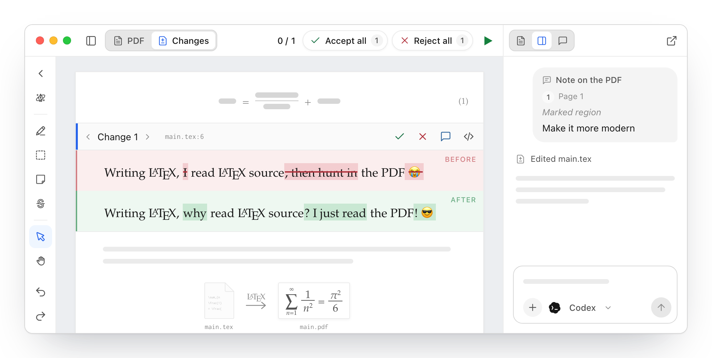
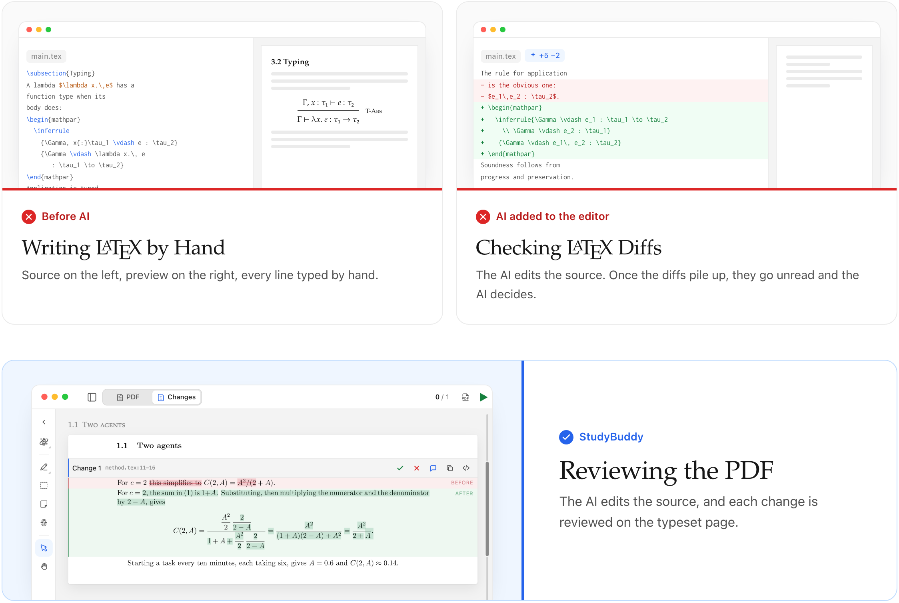
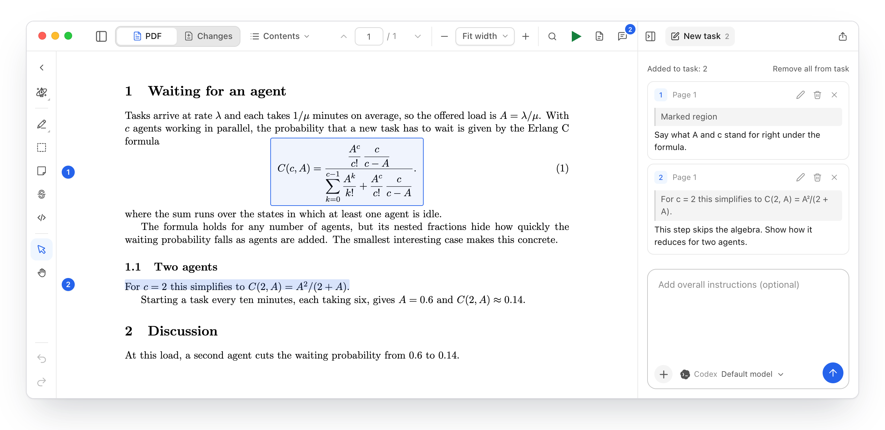

 **Next-Generation AI LaTeX Editor**

# Don't read or write `.tex` Just work on the 

A **new paradigm** for responsible writing and typesetting with AI.

<!-- BEGIN BADGES -->

<!-- END BADGES -->

<a href="README.md">English</a>&nbsp;· <a href="docs/readme/README.zh-CN.md">简体中文</a>&nbsp;· <a href="docs/readme/README.zh-Hant.md">繁體中文</a>&nbsp;· <a href="docs/readme/README.ja.md">日本語</a>&nbsp;· <a href="docs/readme/README.ko.md">한국어</a>&nbsp;· <a href="docs/readme/README.de.md">Deutsch</a>&nbsp;· <a href="docs/readme/README.fr.md">Français</a>&nbsp;· <a href="docs/readme/README.es.md">Español</a>&nbsp;· <a href="docs/readme/README.pt.md">Português</a>&nbsp;· <a href="docs/readme/README.it.md">Italiano</a>&nbsp;· <a href="docs/readme/README.sv.md">Svenska</a>

<a href="https://papilot.ai">
<picture>
  <source media="(prefers-color-scheme: dark) and (max-width: 600px)" srcset="docs/assets/readme-showcase/hero-compact-dark.png">
  <source media="(prefers-color-scheme: dark)" srcset="docs/assets/readme-showcase/hero-dark.png">
  <source media="(max-width: 600px)" srcset="docs/assets/readme-showcase/hero-compact.png">
  
</picture>
</a>

## 📄 You care about the PDF Not the `.tex` behind it

Papers, theses, books, slides: readers only ever see the typeset page. 
**So the page is where you should work, too.**

  <picture>
    <source media="(prefers-color-scheme: dark) and (max-width: 600px)" srcset="docs/assets/readme-showcase/paradigm-compact-dark.png">
    <source media="(prefers-color-scheme: dark)" srcset="docs/assets/readme-showcase/paradigm-dark.png">
    <source media="(max-width: 600px)" srcset="docs/assets/readme-showcase/paradigm-compact.png">
    
  </picture>

**No more compiling diffs in your head.** 
A source diff makes you *imagine* the PDF. StudyBuddy *shows* it to you, typeset.

## 👉 Point at the page and say what you want

Mark a sentence, an equation or a figure, and write a note. 
**Your agent finds the source. You never open a `.tex` file.**

  <picture>
    <source media="(prefers-color-scheme: dark) and (max-width: 600px)" srcset="docs/assets/readme-showcase/notes-app-compact-dark.png">
    <source media="(prefers-color-scheme: dark)" srcset="docs/assets/readme-showcase/notes-app-dark.png">
    <source media="(max-width: 600px)" srcset="docs/assets/readme-showcase/notes-app-compact.png">
    
  </picture>

## 🔒 Your files stay yours

 &nbsp;**Plain files on your machine.** Every change lands in your Git history.

 &nbsp;**Sync with coauthors through Git.** Pull, push, and let an agent resolve conflicts.

 &nbsp;**Free and open source.** MIT licensed, for macOS, Linux and Windows.

## 🤖 Bring the AI agent you already use

<!-- BEGIN AGENT ICONS -->

  <a href="docs/guide.md#agents">
    <picture>
      <source media="(prefers-color-scheme: dark) and (max-width: 600px)" srcset="docs/assets/readme-agents/compact-dark.svg">
      <source media="(prefers-color-scheme: dark)" srcset="docs/assets/readme-agents/desktop-dark.svg">
      <source media="(max-width: 600px)" srcset="docs/assets/readme-agents/compact.svg">
      
    </picture>
  </a>

<!-- END AGENT ICONS -->

## 📥 Downloads

<!-- BEGIN DOWNLOADS -->
| System / distribution | Download / package | Install / run |
| --- | --- | --- |
| <picture><source media="(prefers-color-scheme: dark)" srcset="docs/assets/readme-icons/apple-dark.svg"></picture> **macOS** | [Apple Silicon](https://github.com/XuYouo/StudyBuddy/releases/latest) · [Intel](https://github.com/XuYouo/StudyBuddy/releases/latest) DMG / ZIP | Open the DMG and drag StudyBuddy to Applications. |
| <picture><source media="(prefers-color-scheme: dark)" srcset="docs/assets/readme-icons/windows-dark.svg"></picture> **Windows** | [Installer](https://github.com/XuYouo/StudyBuddy/releases/latest) · [Portable](https://github.com/XuYouo/StudyBuddy/releases/latest) x64 | Run the installer or open the portable executable. |
|   **Ubuntu / Debian / Linux Mint** | [.deb](https://github.com/XuYouo/StudyBuddy/releases/latest) | `sudo apt install ./StudyBuddy-*.deb` |
| <picture><source media="(prefers-color-scheme: dark)" srcset="docs/assets/readme-icons/linux-dark.svg"></picture> **Fedora / Arch / openSUSE** | [AppImage](https://github.com/XuYouo/StudyBuddy/releases/latest) | `chmod +x StudyBuddy-*.AppImage` `./StudyBuddy-*.AppImage` |
|  **NixOS** | [Nix flake](docs/nix.md#nixos-flake) | [Add to your `flake.nix`](docs/nix.md#nixos-flake) |
| **macOS / Linux / Windows (CLI)** | [npm](https://github.com/XuYouo/StudyBuddy/blob/main/docs/development-macos.md) | `npm install -g .` |

Linux packages are x86_64 and tested on Ubuntu 22.04. See [desktop setup](desktop/README.md#build-and-run) for dependencies and AppImage/FUSE help.

The npm package opens the browser interface and requires Node.js 22.22+. Nix requires flakes; see [Nix setup](docs/nix.md#nixos-flake).
<!-- END DOWNLOADS -->

## 🚀 Get started

1. **Install.** [Download the app](#downloads) for macOS, Linux or Windows, or run `npm install -g .` (Node.js 22.22+). You also need Git and TeX Live or MacTeX.
2. **Open your project.** Choose the folder with your `.tex` files. StudyBuddy builds the PDF.
3. **Pick an agent.** Use the CLI login or API key you already have, then mark up the page.

Want a sample first? Run `studybuddy demo`. Details are in the [guide](docs/guide.md#install-and-run).

## 🤝 Community

 &nbsp;**Found a bug or missing a feature?** [Open an issue](https://github.com/XuYouo/StudyBuddy/issues/new/choose), even a rough one.

 &nbsp;**Have a question or an idea?** [Start a discussion](https://github.com/XuYouo/StudyBuddy/discussions).

 &nbsp;**Become a contributor.** Pull requests are very welcome, including ones written with AI agents. Start with the [contributing guide](.github/CONTRIBUTING.md).

## Contributors

  <a href="https://github.com/XuYouo/StudyBuddy/graphs/contributors">
    <picture>
      <source media="(max-width: 600px)" srcset="docs/assets/readme-contributors/compact.svg">
      
    </picture>
  </a>

## Star History

<a href="https://www.star-history.com/?repos=papilotai%2Fpapilot&type=date&logscale=&legend=bottom-right">
 <picture>
   <source media="(prefers-color-scheme: dark)" srcset="https://api.star-history.com/chart?repos=papilotai/papilot&type=date&theme=dark&legend=bottom-right" />
   <source media="(prefers-color-scheme: light)" srcset="https://api.star-history.com/chart?repos=papilotai/papilot&type=date&legend=bottom-right" />
   
 </picture>
</a>

---

<a href="LICENSE">MIT</a> © 2026 PapilotAI. Thanks to our friends at <a href="https://linux.do/">LINUX DO</a>.

